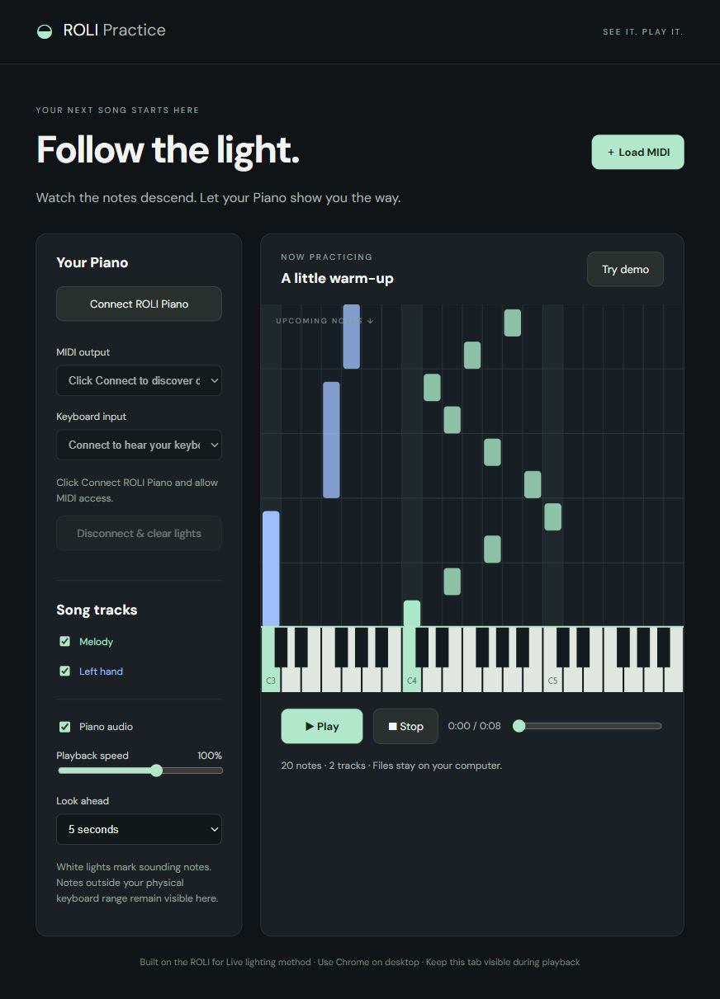

# ROLI Learn 4 All

Learn MIDI songs with falling notes, piano audio, and lights on your ROLI Piano. MIDI files stay on your computer. No Ableton required.

**[Open the player](https://rolilearn4all.sariftech.com/)**



## Get started

1. Open the player in desktop Chrome and connect your Piano by USB.
2. Click **Connect ROLI Piano** and allow MIDI/SysEx access.
3. Select your MIDI output and keyboard input.
4. Load a `.mid` file and press **Play**, or try the demo.

Choose tracks, slow down playback, and adjust how far ahead you see notes. Piano audio is on by default and also responds to your keyboard, including velocity and sustain. **Disconnect & clear lights** sends note releases and turns off key lighting; reconnecting restores brightness.

You may need ROLI's Windows driver. Close Ableton's ROLI control surface while using the player to avoid competing lighting commands. Only notes within your Piano's current octave range can light its keys.

## Run locally

Requires Node.js.

```sh
npm start
```

Open http://localhost:8765. Run `npm test` to check MIDI parsing and lighting messages.

## Deploy

Push to `main` on this GitHub repo to deploy automatically to Heroku. GitHub Actions runs tests on pushes and pull requests.

## License

[MIT](LICENSE). Includes code adapted from ROLI-for-Live and ROLI BLOCKS protocol helpers; see [third-party notices](THIRD_PARTY_NOTICES.md).

